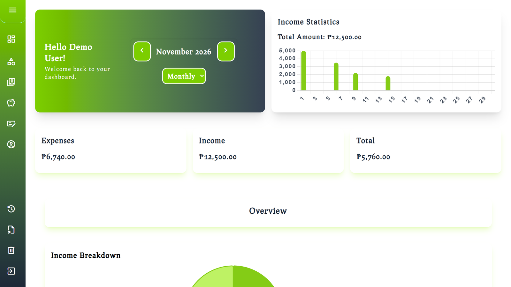
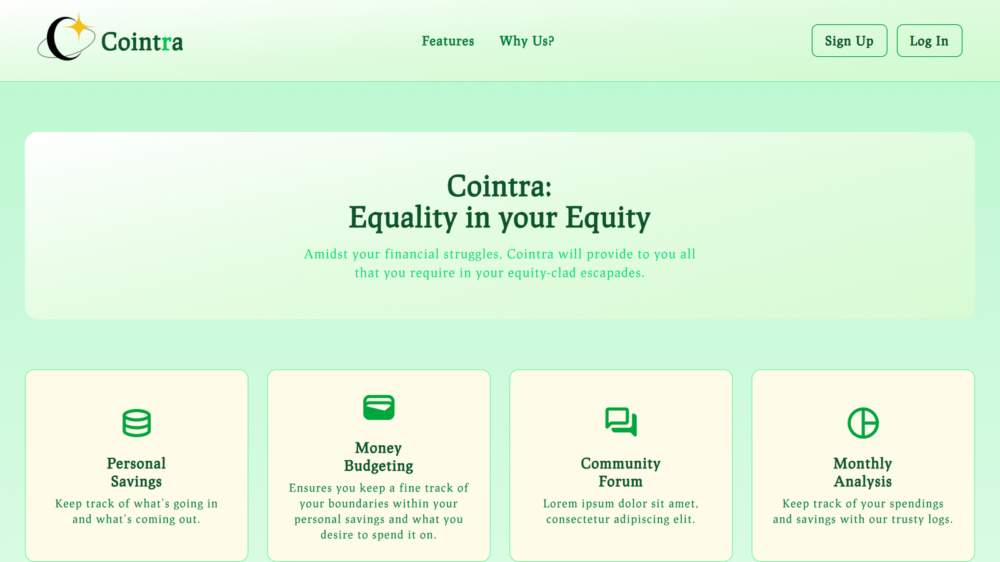
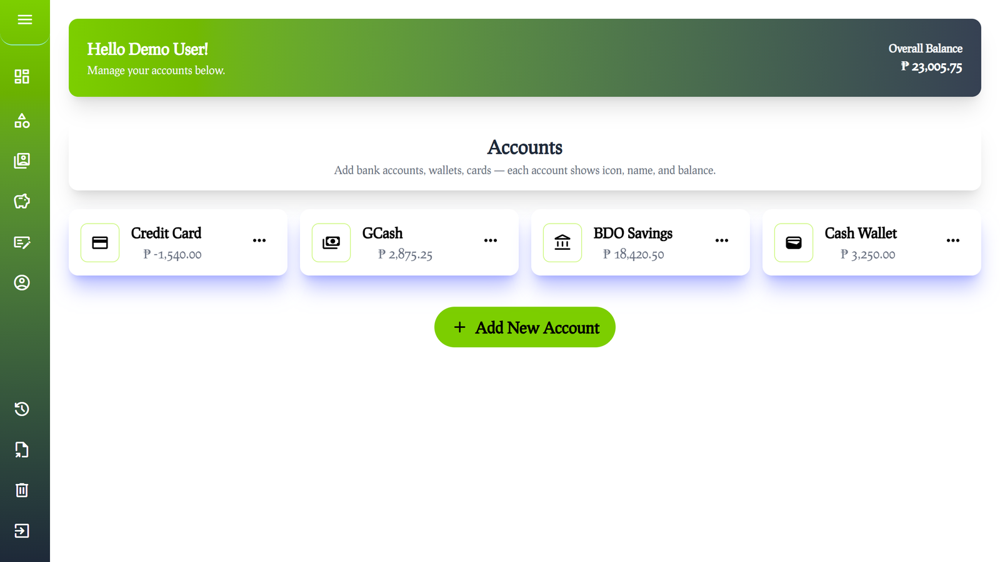
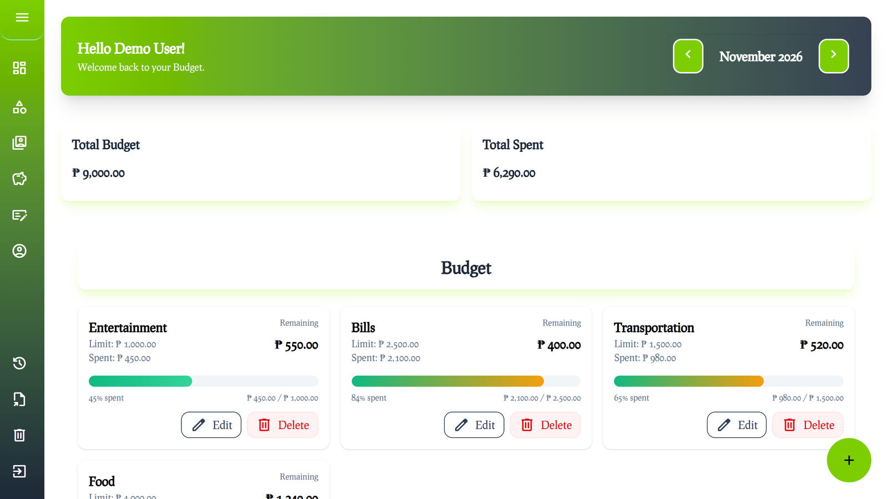

# CoinTra

**A full-stack personal finance web app for tracking income, expenses, budgets and accounts.**

CoinTra helps users manage their money in one place. Users can organize spending into categories, set monthly budgets, record income and expenses across multiple accounts, and export their records. Budget limits are enforced automatically, and every change is recorded in an activity history.


---

## Screenshots



<table>
  <tr>
    <td width="50%"><br><sub>Landing page</sub></td>
    <td width="50%"><br><sub>Accounts page with cash, bank, e-wallet, and credit card balances</sub></td>
  </tr>
  <tr>
    <td width="50%"><br><sub>Budgets page with monthly limits and progress bars per category</sub></td>
  </tr>
</table>

## Features

- **Authentication:** sign up and log in with a username or email; passwords are hashed with PHP's `password_hash`
- **Accounts:** track balances across multiple accounts (for example, wallet, bank or e-wallet); balances update automatically with every transaction
- **Categories:** organize income and expenses into custom categories
- **Monthly budgets:** set a spending limit per category; expenses that would go over the limit are blocked with a warning
- **Transactions:** record income and expenses; the Income and Expense pages include charts that summarize them
- **Activity history:** an audit log of every create, update and delete
- **Export:** download transactions for a selected month as CSV, or as a printable report that can be saved as PDF
- **User profile:** display name, birthday, profile picture and banner
- **Data management:** clear transaction records or reset all data
- **Installable:** includes a web app manifest

## Architecture

The front end and back end are separated by a JSON REST API.

- **`public/`** contains the pages. They use JavaScript `fetch` calls to talk to the API.
- **`api/`** contains the REST endpoints. Each one handles `GET`, `POST`, `PUT` and `DELETE` and returns JSON.
- **`config/`** contains the database connection (PDO) and session helpers.

Every API endpoint requires a logged-in session and only returns the current user's data. All queries use PDO prepared statements to prevent SQL injection.

## My Role

I worked on this team project as the **Full-Stack Developer** and led the team as **Project Manager**.

- Developed a dashboard summarizing income, expenses, and spending by category.
- Co-built the PHP/MySQL backend for recording and managing each user's income and expense records.
- Implemented PDF export of financial statements for users to download.

## Tech Stack

| Area | Technology |
|---|---|
| Front end | HTML, Tailwind CSS, JavaScript, Chart.js |
| Back end | PHP 8 (REST API, PDO) |
| Database | MySQL |
| Local development | Laragon |

## Project Structure

```
CoinTra/
├── api/                    # REST API endpoints
│   ├── auth.php                # Sign up, login, logout, password reset
│   ├── accounts.php
│   ├── budgets.php
│   ├── categories.php
│   ├── transactions.php
│   ├── history.php             # Activity log
│   ├── export.php              # CSV and printable PDF export
│   ├── users.php               # Profile
│   └── maintenance.php         # Clear or reset data
├── config/
│   └── Database.php        # PDO connection and session helpers
├── public/                 # Pages (start at landing.php)
├── assets/                 # Images and logo
├── uploads/                # User-uploaded profile pictures (not committed)
└── database_schema.sql     # MySQL schema
```

## Getting Started

### Prerequisites

- PHP 8 and MySQL, for example through [Laragon](https://laragon.org) or XAMPP

### Installation

1. Clone the repository into your web server folder (for Laragon, `C:\laragon\www`):
   ```bash
   git clone https://github.com/yeldsg/cointra.git
   ```
2. Create a MySQL database named `cointra` and import `database_schema.sql` (for example, through phpMyAdmin or HeidiSQL).
3. If your MySQL login is not `root` with no password, update the settings in `config/Database.php`.
4. Open `http://localhost/cointra/public/landing.php` in your browser.

### First Use

1. Create an account with **Sign Up**.
2. Add your **categories**, then your **accounts**, then a **budget**.
3. You can now record transactions on the **Transactions** page.

## Known Limitations

- **Password reset is for local demonstration only.** It checks the email address but does not send a verification code, so it should not be used on a public server without adding email verification.
- The app is designed to run locally and has not been deployed.

## About This Project

CoinTra was built as a team project for a web development course (September – December 2025).

## Author

**Kathrina Marhiel Zamora** · BS Information Technology, Pampanga State University
GitHub: [@yeldsg](https://github.com/yeldsg) · Portfolio: [yeldsg-portfolio.vercel.app](https://yeldsg-portfolio.vercel.app) · LinkedIn: [linkedin.com/in/yeldsg](https://www.linkedin.com/in/yeldsg)
